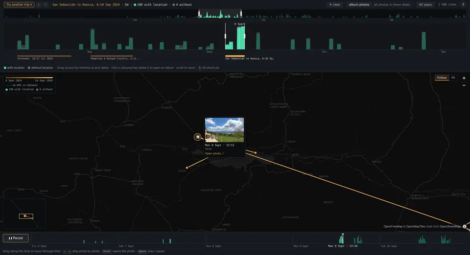

# Retrace for Immich

<p align="center">
  <a href="https://immich-retrace-demo.holoskii.me"></a>
</p>
<p align="center"><b><a href="https://immich-retrace-demo.holoskii.me">Try the live demo</a></b> (sample photos, no install)</p>

https://github.com/user-attachments/assets/08ff7afe-58c6-4d4d-be16-06faf7102174

I love travelling and always return home with a bunch of photos. But looking through them on their
own doesn't give me the feeling of "where exactly was this?", so I created Retrace, a companion app
for [Immich](https://immich.app). It uses the GPS metadata in your photos and shows them on a map.

It has a few main uses:

- see on a map where I've been
- see my photo and travel activity over the year: the timeline shows the peaks
- relive a trip on the map, photo by photo

Pick a trip album, or drag over any period on the timeline. It works for moving around a city
(though photo GPS accuracy becomes the limit there) and for big trips across different cities, all
without a separate GPS tracker! It only reads from Immich and never changes anything.

There's an open demo you can try, but Retrace works MUCH better on albums with dense photo activity
(and I didn't want to share my own photos for a demo xD).

The demo has a phone layout, but the app is built primarily for desktop.

**Not affiliated with Immich.** This is an independent project; "Immich" is used only to say what it
works with.

## Quick start

You need Immich v3 and Docker. In Immich, create an API key (Account Settings → API Keys → New API
Key) with exactly these permissions: `asset.read`, `asset.view`, `album.read`.

Then add Retrace to Immich's own `docker-compose.yml`:

```yaml
  immich-retrace:
    container_name: immich-retrace
    image: ghcr.io/holoskii/immich-retrace:latest
    environment:
      IMMICH_URL: http://immich-server:2283
      IMMICH_API_KEY: ${IMMICH_RETRACE_API_KEY}   # put IMMICH_RETRACE_API_KEY=… in Immich's .env
      # IMMICH_PUBLIC_URL: https://photos.example.com   # optional: "Open in Immich" links
    ports:
      - 127.0.0.1:8080:8080
    restart: unless-stopped
```

`docker compose up -d immich-retrace` and open http://127.0.0.1:8080. Running it on its own,
without Docker, other settings, updating and troubleshooting: [DEPLOYMENT.md](DEPLOYMENT.md).

## Security

**Retrace has no login of its own.** Anyone who can reach it sees your whole library. Keep it on
`127.0.0.1` or a private network, or put it behind a reverse proxy with authentication on every
path ([how](DEPLOYMENT.md#security)).

## Contributing

Bug reports and ideas are welcome in [issues](https://github.com/holoskii/immich-retrace/issues).
How the code is laid out and why: [ARCHITECTURE.md](ARCHITECTURE.md).

## License

MIT, see [LICENSE](LICENSE). The public demo's sample data under `demo/` is not covered by it: each
photo keeps its own licence (CC BY 4.0 or CC BY-SA 4.0), listed per file with its author and source
in that directory.
